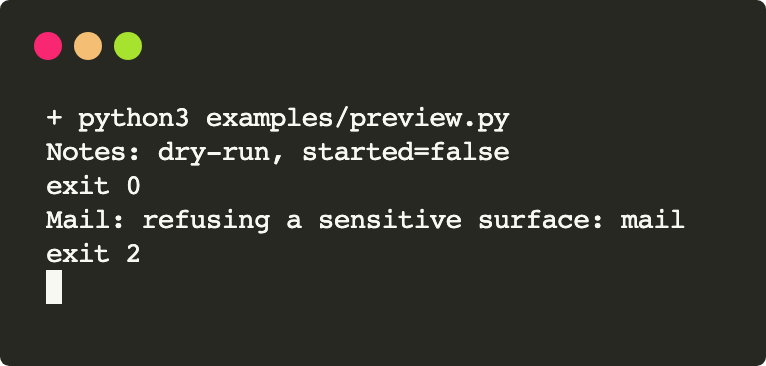

# jev-brain

Preview a desktop action your agent proposes. Get a JSON plan for Notes or a refusal for Mail before a runner starts.



**Try it with Git and uv** (Python 3.11+). This installs the CLI in an isolated environment and runs the Notes sample.

```sh
uvx --from git+https://github.com/talalkashar/jev-brain \
  systemone use --target Notes --request "count the windows"
```

Look for `"mode": "dry-run"` and `"started": false`. Notes can be closed. No account, API key, model, desktop permission or `jev-run` is needed.

**With Git and Python alone**, paste this into a macOS or Linux shell to reproduce both outcomes in the screenshot.

```sh
git clone https://github.com/talalkashar/jev-brain && \
  cd jev-brain && python3 examples/preview.py
```

## Status

The repository is **jev-brain**. The package and CLI are **SystemOne** (`systemone`, version 0.1.0). Use it when you are wiring an agent to a desktop workflow and want to test the handoff and refusal paths. The caller supplies the target and request. This version previews the request and performs no desktop step.

| What you can try | What you need |
| --- | --- |
| Preview a handoff or exercise a refusal | The CLI alone |
| Test closed questions through HTTP or MCP | The included local mock server |
| Start an external runner with `--arm` | A separately obtained, trusted, compatible `jev-run` on PATH |

## Install the CLI

From the checkout, create a persistent environment for the CLI and MCP server.

```sh
python3 -m venv .venv && .venv/bin/python -m pip install .
. .venv/bin/activate
systemone --version
```

On Windows PowerShell use `py -3 -m venv .venv`, then `.\.venv\Scripts\python.exe -m pip install .`. Run `.\.venv\Scripts\systemone.exe --version`. The runtime has no third-party Python dependencies. Install from this repository. The project has no PyPI release.

## Use it in a workflow

- **Inspect a handoff or handle a refusal.** Read JSON on success. A rejected request exits 2 with a reason on stderr. [Runnable examples](examples/README.md)
- **Exercise a decision client.** Send the included build-failure fixture to a local server and check which label comes back. The mock always picks the first choice. [Queue example](examples/README.md#3-test-a-queue-integration-with-a-fixed-answer)
- **Connect an agent.** Claude Code, Codex and Cursor can start `systemone-mcp` over stdio. It exposes `health` and `decide`. Desktop previews use the CLI. [Client configuration](docs/clients.md) · [Bundled skill](src/systemone/skill/SKILL.md)

## Limits

- The guard checks the **text you supply** against patterns for banking, mail, messages, password managers, student records, admin consoles and logins. It cannot see which window is open or verify what a target really is. The caller remains responsible for authorization.
- `--arm` starts the executable found as `jev-run` and passes `--expect TARGET --target TARGET --text REQUEST`. SystemOne never passes `--act`. External code controls its own behavior. If you see `jev-run is not on PATH`, omit `--arm` to continue in preview mode. This repository supplies neither that runner nor access to TypeSafe.
- `systemone serve --mock` binds to loopback by default. Its probability, choice and score answers are fixed. It does not evaluate the meaning of your input or download model weights. Keep private data out of targets, requests and questions.

[Security](SECURITY.md) · [Contributing and tests](CONTRIBUTING.md) · [Changelog](CHANGELOG.md) · [MIT license](LICENSE)
